# Finals Lab Activity 1 — Hand coding manual

**Branch:** `finallabact1` on [ichigokekiii/laravel-elec](https://github.com/ichigokekiii/laravel-elec)  
**PDF version:** `Acuesta_John_Constantine_Finals_LabActivity1_INSTRUCTION.pdf` (generated from this doc)  
**Assumes:** Lab 2 and Lab 3 done (admin CRUD, `role` middleware, categories, soft delete, Form Request validation).

Official instructor reference in repo: `docs/Laravel_CRUD_Soft_Delete_Watermark_Intervention_v4.pdf`.  
Demo script: `docs/FINALS-LAB-ACT-1-DEMO-SCRIPT.md`. Code explanation: `docs/FINALS-LAB-ACT-1-CODE.md`.

---

## Data shape (read this first)

| Field | Meaning |
| --- | --- |
| `image` (DB) | Relative path on Laravel `public` disk, e.g. `products/550e8400-e29b-41d4-a716-446655440000.webp` |
| Upload (HTTP) | Multipart file, JPG/PNG/WebP, max 3 MB |
| Stored bytes | WebP, max width 1000px, watermark bottom-right |
| Public URL | `/storage/` + path (requires `storage:link`) |

---

## Step 1 — Before you start

**Lab 2/3 checklist (any project name):**

- [ ] Admin routes behind `auth` + admin role
- [ ] User role blocked from admin URLs (403)
- [ ] CRUD for bouquets/products with soft delete and trash routes
- [ ] Categories and `category_id` on create/edit
- [ ] Shared Form Request for title, body, price, category

**Petal Express demo:**

```bash
cd petal-express
php artisan migrate
php artisan db:seed
php artisan serve
```

Open http://127.0.0.1:8000 — admin `admin@test.com` / `123`.

---

## Step 2 — Install Intervention Image and storage link

```bash
cd petal-express
composer require intervention/image-laravel
php artisan storage:link
```

Add watermark asset: `public/images/watermark.png` (copy from `finallabact1` if needed).

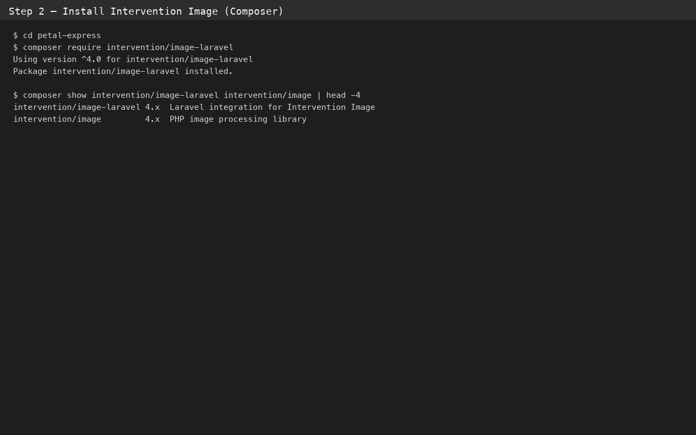

**Verify:** `composer.json` contains `"intervention/image-laravel": "^4.0"`. Symlink `public/storage` exists.

---

## Step 3 — Database column

In Petal Express, `showcase_flowers.image` is nullable string in migration `2026_09_23_234450_create_showcase_flowers_table.php`.

Add `image` to model `$fillable` in `app/Models/Post.php`.

---

## Step 4 — PostRequest image rules

In `app/Http/Requests/PostRequest.php`:

- **POST (create):** `required`, `image`, `mimes:jpg,jpeg,png,webp`, `max:3072`
- **PUT/PATCH (edit):** same but `nullable` instead of `required`

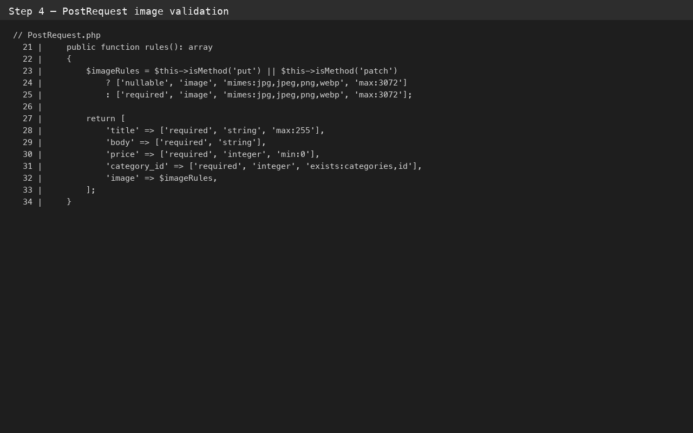

---

## Step 5 — AdminPostController

Imports:

```php
use Intervention\Image\Alignment;
use Intervention\Image\Format;
use Intervention\Image\Laravel\Facades\Image;
```

**store:** `'image' => $this->saveWatermarkedImage($request->file('image'))`

**update:** if new file, save new WebP, update row, delete old path from `Storage::disk('public')`.

**forceDelete:** after `$post->forceDelete()`, `Storage::disk('public')->delete($imagePath)`.

**saveWatermarkedImage** (private):

1. `Image::decode($file)`
2. `$image->scaleDown(width: 1000)`
3. Load `public_path('images/watermark.png')`, scale watermark width (max 320, ~38% of photo width)
4. `$image->insert($watermark, 12, 12, Alignment::BOTTOM_RIGHT, 0.55)`
5. `$path = 'products/'.Str::uuid().'.webp'`
6. `Storage::disk('public')->put($path, (string) $image->encodeUsingFormat(Format::WEBP, quality: 80))`

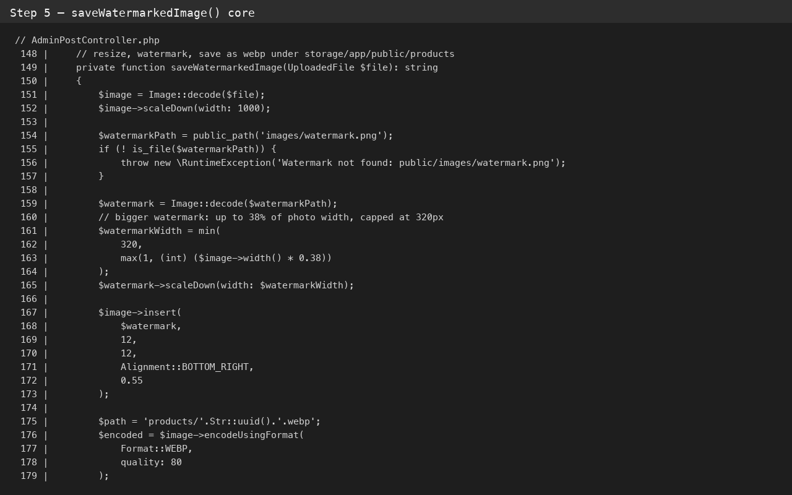

---

## Step 6 — displayImageUrl()

On `Post` model: if `image` set and file exists on public disk, return `'/storage/'.ltrim($this->image, '/')`. Else fallback gallery URL.

Use in Blade: `$post->displayImageUrl()` on admin index, trash, home, bouquets index/show, favorites.

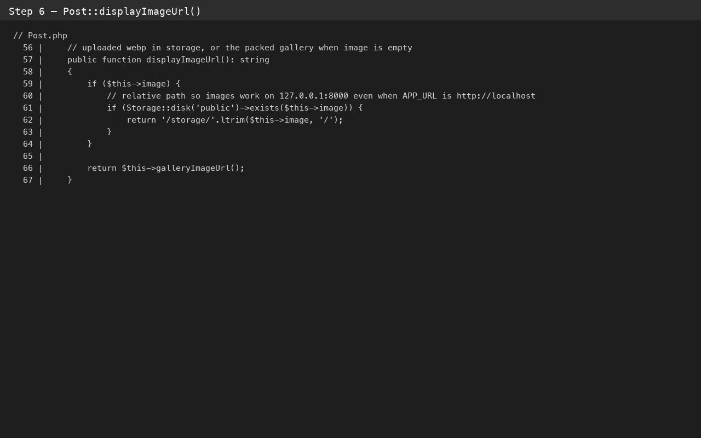

---

## Step 7 — Blade forms and preview

**create.blade.php / edit.blade.php:**

- `enctype="multipart/form-data"` on form
- `<input type="file" name="image" accept="image/jpeg,image/png,image/webp">`
- Helper text: JPG, PNG, WebP, max 3 MB

**Optional:** `admin-photo-preview-shell` Alpine modal for watermark inspection on admin lists.

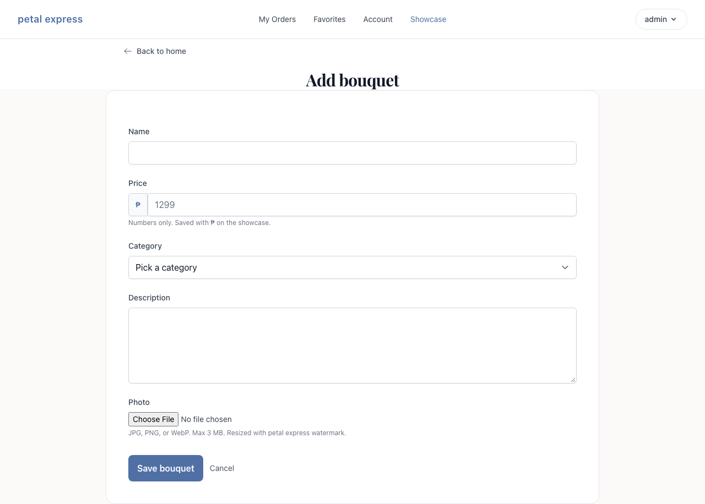  
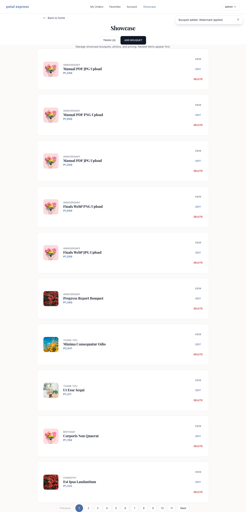  
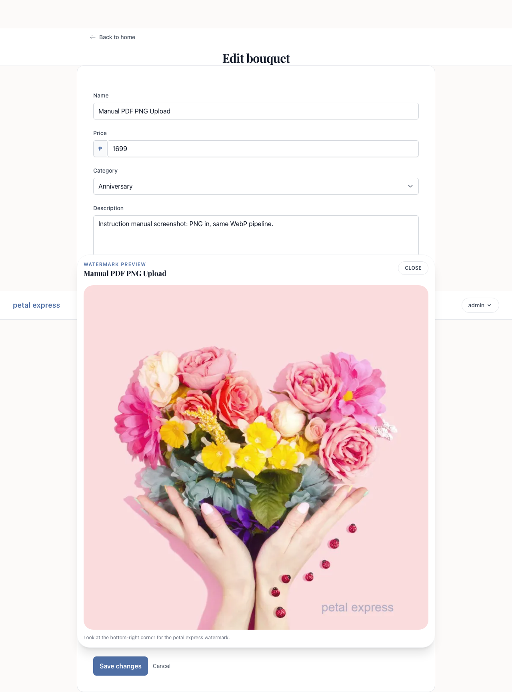

---

## Step 8 — Soft delete vs force delete

| Action | Database | File on disk |
| --- | --- | --- |
| `destroy()` soft delete | `deleted_at` set | WebP **kept** |
| `forceDelete()` | row removed | WebP **deleted** |

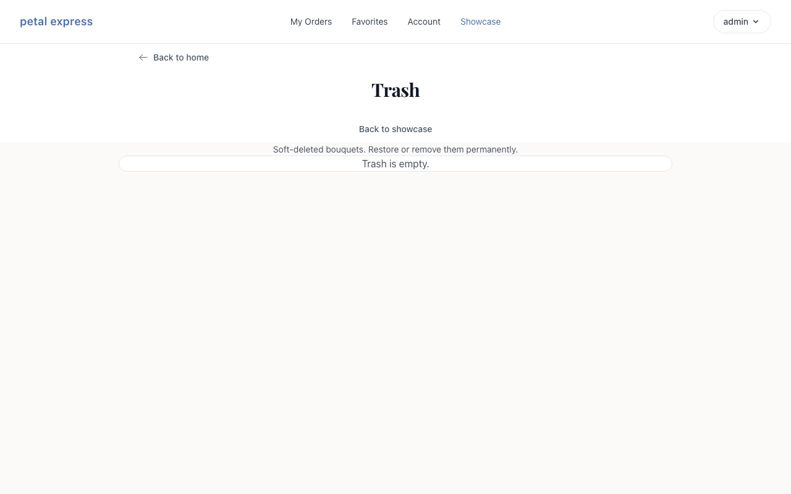

---

## Step 9 — Feature test

File: `tests/Feature/LabActFourInterventionTest.php`

```bash
php artisan test --filter=LabActFourInterventionTest
```

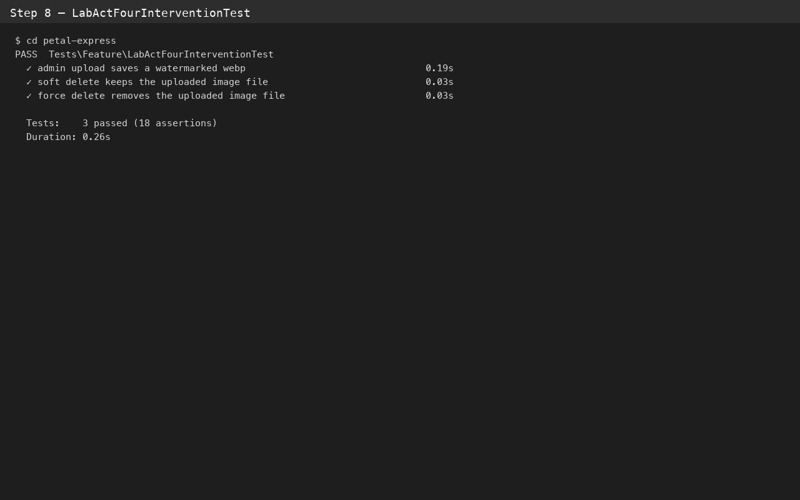

---

## Step 10 — Live demo

Follow `docs/FINALS-LAB-ACT-1-DEMO-SCRIPT.md`. Confirm disk:

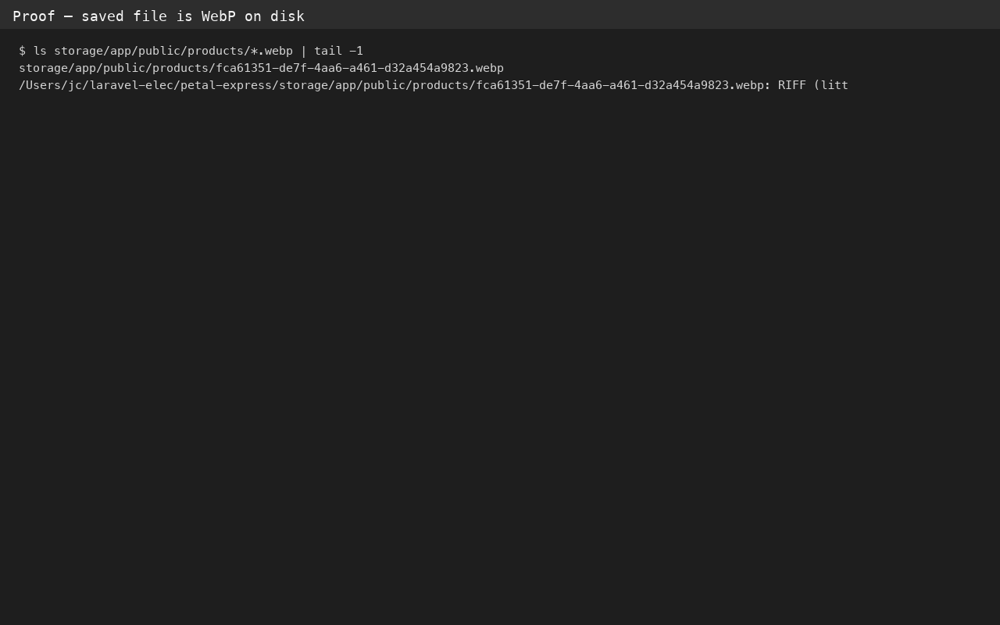  
  
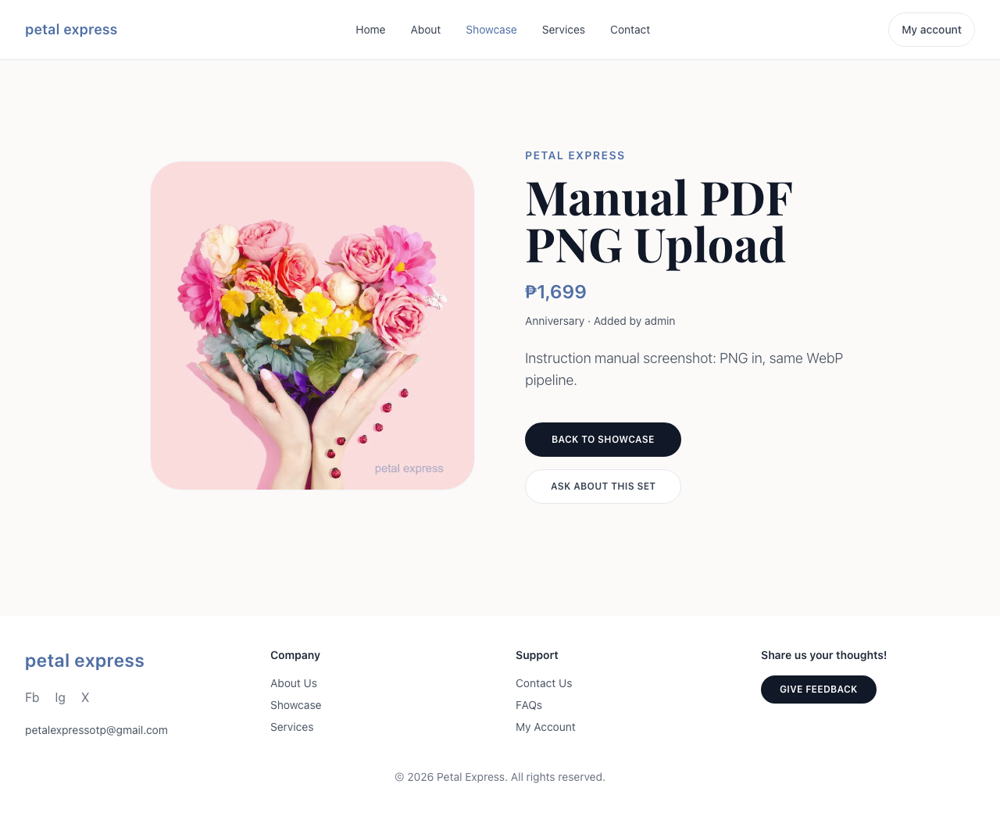

Showcase list thumbnails are too small to see the watermark. Use admin preview or the public detail page.

---

## Proof pages (full size, same shots as the submitted PDF)

These figures are one page each in the instruction PDF. Submit shots live in `progress-shots-finals-lab1/`.

1. Composer and storage link
2. Automated test output
3. Disk proof that the file is WebP
4. Admin create form
5. JPG upload toast
6. PNG upload toast
7. Edit thumbnail
8. Watermark preview modal (`24-watermark-preview-modal.png`)
9. Watermark close-up (`manual-shots-finals-lab1/14b-watermark-closeup.png`)
10. Public showcase
11. Public detail with watermark (`26-public-bouquet-detail-photo.png`)
12. Trash after soft delete
13. Rubric checklist

Showcase thumbs are too small to read the watermark. Use pages 8, 9, and 11.

| Rubric item | Code / route |
| --- | --- |
| Intervention v4 | `composer.json`, `Image` facade |
| storage:link | `public/storage` → `storage/app/public` |
| Upload mimes | `PostRequest` `image` rules |
| Resize + watermark | `AdminPostController::saveWatermarkedImage()` |
| WebP storage | `products/*.webp` on `public` disk |
| Public display | `Post::displayImageUrl()` in showcase views |
| Soft vs force file | `destroy` vs `forceDelete` in controller |
| Automated proof | `LabActFourInterventionTest` |

---

## Oral defense one-liners

See Appendix C in the instruction PDF (same bullets as `ORAL_LINES` in `build-instruction-pdf-finals-lab1.py`).

---

## Rebuild instruction PDF

```bash
cd petal-express
php artisan migrate
php artisan db:seed
php artisan serve
```

Second terminal:

```bash
cd docs
python3 make-terminal-shots-manual-finals-lab1.py
node capture-manual-finals-lab1.cjs
python3 build-instruction-pdf-finals-lab1.py
```

Output: `docs/Acuesta_John_Constantine_Finals_LabActivity1_INSTRUCTION.pdf`
