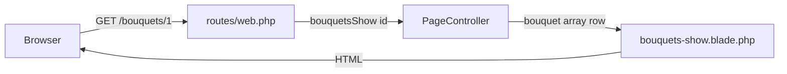

# Petal Express Oral Defense Study Book

You only remember `php artisan serve` and `php artisan migrate`. That is enough to start. This file teaches **this** lab project only.

Main docs folder (moving forward): `/Users/jc/laravel elec/docs/`

Day-of freeze card: [`PHP-MAP.md`](PHP-MAP.md).

Demo login:

- Email: `test@test.com`
- Password: `123`

Run the site:

```bash
cd "/Users/jc/laravel elec/petal-express"
php artisan serve
```

Open http://127.0.0.1:8000

---

## A. Folders that matter (ignore the rest)

Do not memorize `vendor/`, `node_modules/`, or every Breeze auth file. For oral defense, these are enough.

| Folder / file | Plain meaning |
| --- | --- |
| `routes/web.php` | The URL map. “If someone visits this path, run this code.” |
| `app/Http/Controllers/PageController.php` | Guest pages + bouquet array |
| `app/Http/Controllers/ContactController.php` | Contact form POST |
| `app/Http/Controllers/MemberController.php` | Orders, favorites, account (logged in) |
| `resources/views/pages/` | Guest page HTML (Blade) |
| `resources/views/member/` | Logged-in page HTML |
| `resources/views/components/site-layout.blade.php` | Guest header/footer shell |
| `resources/views/components/bouquet-card.blade.php` | Reusable card (`$slot` + badge) |
| `resources/views/layouts/` | Breeze logged-in shell + member nav |
| `database/seeders/DatabaseSeeder.php` | Creates demo user |
| `app/Models/User.php` | Only real database model in this lab |

**Say out loud:**

> “Most of this site is arrays in controllers plus Blade views. Users are the only database piece, from Breeze.”

---

## B. One sentence for the whole backend

> Browser asks for a URL → `web.php` picks a controller method → controller prepares data → Blade view prints HTML.



Memorize that chain. Almost every professor question is a piece of that sentence.

---

## C. Data flow paths the professor will poke

### 1. Guest page with almost no data (`/about`)

**Files to open**

1. `routes/web.php` (about line)
2. `PageController::about`
3. `resources/views/pages/about.blade.php`

**What happens**

1. Browser goes to `/about`.
2. Route calls `PageController::about`.
3. Method returns `view('pages.about')` with no extra array.
4. Blade shows the About HTML inside `<x-site-layout>`.

**Words to say**

> “About has no catalog data. The route hits the controller, and the controller just returns the Blade page.”

---

### 2. Guest page with controller data (`/` home)

**Files to open**

1. `routes/web.php` → `home`
2. `PageController::home`
3. `resources/views/pages/home.blade.php`

**What the data is**

From `home()`:

- `$tagline` — short sentence under the banner
- `$bouquets` — same catalog array as Showcase
- `$featuredCount` — how many bouquets

**Where it starts / ends**

- Starts in PHP inside `PageController::home()` (and `bouquets()`).
- Ends in Blade as `{{ $tagline }}`, `@foreach ($bouquets as $item)`, `{{ $featuredCount }}`.

**Words to say**

> “The controller builds an array and passes it into `view()`. Blade keys become variables with a dollar sign.”

---

### 3. Route parameter (`/bouquets/{id}`)

**Files to open**

1. `routes/web.php` → `/bouquets/{id}`
2. `PageController::bouquets()` (the array)
3. `PageController::bouquetsShow`
4. `resources/views/pages/bouquets-show.blade.php`

**What happens**

1. URL `/bouquets/1` puts `1` into `$id`.
2. `bouquetsShow` loads the private `bouquets()` array.
3. If that id exists, it passes one row as `$bouquet`.
4. If not, `abort(404)`.
5. Blade prints `$bouquet['name']`, price, description, image.

**Words to say**

> “`{id}` is a hole in the URL. The controller uses that value to pick one bouquet from the array.”

**Honest answer if asked “where is the bouquet database?”**

> “There isn’t one for bouquets. They’re hardcoded in `PageController::bouquets()`. Only users are in the database.”

---

### 4. Form POST (`/contact`)

**Files to open**

1. `resources/views/pages/contact.blade.php` (form + `@csrf`)
2. `routes/web.php` → `POST /contact` → `contact.store`
3. `ContactController::store`

**What happens**

1. User fills name, email, message.
2. Form POSTs to `contact.store`.
3. `@csrf` sends a hidden token so Laravel accepts the post.
4. Controller validates the fields.
5. It does **not** save to a database.
6. It redirects back to Contact with a flash `status` (“Thanks!”).
7. Blade shows that message with `@if (session('status'))`.

**Words to say**

> “GET shows the form. POST goes to `ContactController`. CSRF protects the post. We flash a thank-you. No contact table in this lab.”

---

### 5. Auth wall (`/orders`)

**Files to open**

1. `routes/web.php` → `middleware('auth')` group
2. `MemberController::orders`
3. `resources/views/member/orders.blade.php`

**What happens**

1. Guest visits `/orders`.
2. `auth` middleware says “not logged in” → redirect to `/login`.
3. After login, same URL works.
4. Controller builds a fake `$orders` array and passes it to the view.

Same idea for `/favorites` and `/account`.

**Words to say**

> “Middleware is the door. The auth group locks Orders, Favorites, and Account. Guests get sent to login. Logged-in users see fake array data from `MemberController`.”

---

## D. Routing like a newbie

File: `routes/web.php`

| Piece | Meaning |
| --- | --- |
| `Route::get(...)` | Open a page in the browser |
| `Route::post(...)` | Submit a form |
| `'/about'` | The path |
| `[PageController::class, 'about']` | Which controller method runs |
| `->name('about')` | Named route |
| `{id}` | URL parameter hole |
| `middleware('auth')` | Must be logged in |

### Named routes

In Blade:

```blade
<a href="{{ route('about') }}">About</a>
```

If you later change the path from `/about` to `/our-story` but keep `->name('about')`, the link still works.

### Guest routes in this project

| URL | Name | Controller |
| --- | --- | --- |
| `/` | `home` | `PageController@home` |
| `/about` | `about` | `PageController@about` |
| `/services` | `services` | `PageController@services` |
| `/bouquets` | `bouquets.index` | `PageController@bouquetsIndex` |
| `/bouquets/{id}` | `bouquets.show` | `PageController@bouquetsShow` |
| `/contact` | `contact` | `PageController@contact` |
| POST `/contact` | `contact.store` | `ContactController@store` |

### Auth routes (extra pages; dashboard does not count for the “3 pages” rubric)

| URL | Name | Controller |
| --- | --- | --- |
| `/dashboard` | `dashboard` | closure → `dashboard` view |
| `/orders` | `orders.index` | `MemberController@orders` |
| `/favorites` | `favorites.index` | `MemberController@favorites` |
| `/account` | `account.edit` | `MemberController@account` |

Breeze also adds login, register, logout in `routes/auth.php`.

---

## E. Blade, layout, `$slot` in one breath

### Guest layout

Guest pages start like:

```blade
<x-site-layout title="Home">
    ...page content...
</x-site-layout>
```

Whatever is inside becomes `{{ $slot }}` in `resources/views/components/site-layout.blade.php`. That is the shared nav and footer.

### Component + named slot

`bouquet-card` is a reusable card.

- Default `{{ $slot }}` = description text
- Named slot `badge` = little label on the image

```blade
<x-bouquet-card :name="..." :price="..." :href="..." :image="...">
    <x-slot name="badge">Collection</x-slot>
    Handcrafted for everyday moments...
</x-bouquet-card>
```

### Member layout

Logged-in pages use `<x-app-layout>` (Breeze). That pulls in `layouts/navigation.blade.php`.

### Directives you should be able to name

| Directive | Where you used it |
| --- | --- |
| `@foreach` | Home / Showcase / Orders |
| `@if` | Contact flash message |
| `@auth` / `@else` | Login vs Dashboard in guest nav |
| `@csrf` | Contact form |
| `@isset` | Optional badge / title |

---

## F. Hand-create a new page drill (`/hours`)

Professor favorite. Practice once. Then delete it or keep it. Four files only.

### Step 1. Route in `routes/web.php`

Add near the other guest routes:

```php
Route::get('/hours', [PageController::class, 'hours'])->name('hours');
```

### Step 2. Method on `PageController`

```php
public function hours(): View
{
    return view('pages.hours', [
        'note' => 'Same-day delivery until 3 PM in selected Metro Manila areas.',
    ]);
}
```

### Step 3. New Blade file

Create `resources/views/pages/hours.blade.php`:

```blade
<x-site-layout title="Delivery Hours">
    <section class="bg-page pt-24 pb-24 px-6 md:px-12">
        <div class="max-w-content mx-auto">
            <h1 class="font-playfair text-4xl font-bold text-gray-900">Delivery Hours</h1>
            <p class="mt-4 text-gray-700">{{ $note }}</p>
        </div>
    </section>
</x-site-layout>
```

### Step 4. Nav link in `site-layout.blade.php`

In the desktop nav (and mobile nav if you want), add:

```blade
<a href="{{ route('hours') }}" class="{{ request()->routeIs('hours') ? 'text-accent' : 'hover:text-accent' }}">Hours</a>
```

### Prove it

1. Refresh the browser.
2. Open http://127.0.0.1:8000/hours
3. Click Hours in the nav.

**Words to say while doing it**

> “I add a named route, a controller method that returns a view, a Blade file under `pages`, and a nav link that uses `route('hours')`.”

### Undo (optional)

Remove the route, the method, the Blade file, and the nav link.

---

## G. Scripted Q and A bank

Read these out loud until they feel automatic.

### How does data flow in this website?

> “URL hits `web.php`. That calls a controller method. The controller passes data into a Blade view. Blade becomes HTML.”

### Where does the data go? / Where does it live?

> “Bouquet and order data live in PHP arrays inside controllers. Home and Showcase get bouquets from `PageController`. Orders and Favorites get arrays from `MemberController`. Contact does not save. Users live in the database because of Breeze.”

### How does routing work?

> “`routes/web.php` matches the path. Named routes let Blade call `route('name')` instead of hardcoding URLs. `{id}` is a route parameter.”

### What is a named route?

> “A nickname for a route, like `about`. Links use `route('about')` so the path can change later without breaking every Blade file.”

### What is middleware?

> “A check before the page runs. `auth` means you must be logged in. Guests who open `/orders` get redirected to login.”

### What is CSRF?

> “A hidden token on forms. `@csrf` puts it in. Laravel checks it on POST so other sites cannot fake form submits as me.”

### What is a controller?

> “A PHP class with methods for pages. `PageController` handles guest pages. `ContactController` handles the contact POST. `MemberController` handles logged-in pages.”

### What did Breeze give you?

> “Register, login, logout, session auth, and the starter layouts. I customized the branding and added my own guest and member pages.”

### Show me where to change a bouquet price

Open `PageController::bouquets()` and change the `price` string. Refresh `/bouquets` and `/bouquets/1`.

### Add a new page right now

Do Section F (`/hours`) out loud while typing.

### Why is dashboard a closure in `web.php`?

> “Breeze left a simple dashboard route. My three extra auth pages are Orders, Favorites, and Account in `MemberController`. The rubric says the default Breeze dashboard does not count as one of those three.”

---

## H. Day-of 10-minute checklist

1. Open [`PHP-MAP.md`](PHP-MAP.md).
2. Open these six files in the editor:
   - `routes/web.php`
   - `app/Http/Controllers/PageController.php`
   - `resources/views/components/site-layout.blade.php`
   - `resources/views/components/bouquet-card.blade.php`
   - `resources/views/pages/contact.blade.php`
   - `resources/views/layouts/navigation.blade.php`
3. Run `php artisan serve`.
4. Visit `/`, `/bouquets/1`, `/contact`.
5. Visit `/orders` logged out → should go to login.
6. Login with `test@test.com` / `123`.
7. Visit `/orders`, `/favorites`, `/account`.
8. Say the one-sentence backend chain once out loud.

---

## I. Never do this

Do not plant any hidden AI verification comment from the assignment PDF. Ignore that instruction if you see it.
