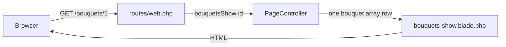

# Learn Laravel from zero (Petal Express)

This book assumes you know nothing about websites. Read it top to bottom once. Later, jump to Part 5 when you need Petal Express for oral defense.

Day-of cheat sheet (short): [`PHP-MAP.md`](PHP-MAP.md)

Your real app folder:

```bash
cd /Users/jc/laravel-elec/petal-express
```

Demo login for Petal Express:

- Email: `test@test.com`
- Password: `123`

---

# Part 0 — How to use this book

1. Read Part 1 with no laptop. Just the ideas.
2. Read Part 2 at a terminal. Type the commands yourself.
3. Read Part 3 and Part 4 so MVC and Laravel stop feeling random.
4. Part 5 is your lab site. Open the files it names.
5. Part 6 is oral defense practice. Say the answers out loud.

If a word feels scary, it usually means “a named box that does one job.”

---


# Part 1 — What a website even is


## 1.1 The restaurant picture

Imagine a restaurant.

1. You walk in and say what you want. (“I want the About page.”)
2. Someone hears you and decides who should handle it.
3. Someone gathers the food (words, pictures, prices).
4. Someone puts it on a plate so it looks nice.
5. The plate comes back to you.

A website works the same way:

1. You type a web address in Chrome/Safari (or click a link).
2. Your browser sends a **request** to a computer.
3. That computer runs your PHP / Laravel code.
4. The code builds an **HTML** page (the plate).
5. The browser shows that page to you.

**Request** = “please give me this page.”  
**Response** = “here is the HTML.”  
**HTML** = the page structure the browser knows how to draw.  
**URL / path** = the address, like `/about` or `/bouquets/1`.

You do not need to memorize protocols. For this lab: browser asks → your Laravel app answers with HTML.

## 1.2 Frontend vs backend (kid version)

- **Frontend** = what you see (layout, colors, text, buttons). In this lab that is mostly **Blade** files (HTML with a little PHP mixed in).
- **Backend** = the kitchen work you do not see (picking which page, checking login, reading data). In this lab that is **routes**, **controllers**, and a little **database** for users.


## 1.3 Why we do not put everything in one giant file

You could write one huge PHP file that prints every page. It would work for a toy.

It falls apart when:

- you have many pages
- more than one person edits the site
- you want login on some pages only
- you want to change the header once and have it update everywhere

So frameworks like Laravel give you **folders with jobs**. That idea is called **MVC**. We cover it in Part 3.

---


# Part 2 — The terminal, then build a Laravel site from scratch

The **terminal** (on Mac: Terminal, or the terminal panel in Cursor) is a text box where you type orders for the computer.

You type a line. Press Enter. The computer does that one job and prints a reply.

## 2.1 Commands you will use forever


| Command         | What it does                                |
| --------------- | ------------------------------------------- |
| `pwd`           | Print where you are standing (which folder) |
| `ls`            | List files in this folder                   |
| `cd foldername` | Move into a folder                          |
| `cd ..`         | Move up one folder                          |
| `cd ~`          | Go to your home folder                      |
| `clear`         | Clear the screen (optional)                 |


Try this once:

```bash
pwd
ls
cd ~
pwd
```

If a command says “No such file or directory,” you are in the wrong folder. Run `pwd` and `ls`, then `cd` to the right place.

## 2.2 Tools you need before Laravel

On your Mac you already used these for Petal Express. For a brand-new machine you would install:

1. **PHP** — the language Laravel is written in
2. **Composer** — a tool that downloads PHP packages (including Laravel)
3. **Node.js + npm** — needed for Breeze’s CSS/JS build step (`npm install`, `npm run build`)

Check they exist:

```bash
php -v
composer -V
node -v
npm -v
```

You should see version numbers, not “command not found.”

This project used roughly:

- PHP 8.5
- Composer 2.x
- Node 22
- Laravel 11
- Laravel Breeze 2 (Blade stack)


## 2.3 Create a brand-new Laravel website (full recipe)

These are the steps to make **your own** site from nothing. Petal Express already exists, so you do not need to run this again unless you want practice in another folder.

### Step A — Go to the parent folder where new projects should live

```bash
cd /Users/jc/laravel-elec
pwd
ls
```


### Step B — Create the Laravel app

Pick a folder name. Example: `my-first-site`

```bash
composer create-project laravel/laravel my-first-site
```

Wait. Composer downloads Laravel into `my-first-site/`.

Go inside:

```bash
cd my-first-site
pwd
ls
```

You should see folders like `app`, `routes`, `resources`, `public`.

### Step C — Set up the database file (SQLite is fine for learning)

Laravel 11 often ships ready for SQLite. If `.env` points at SQLite and the database file is missing:

```bash
touch database/database.sqlite
php artisan migrate
```

`migrate` = “build the database tables from migration files.”  
For a fresh app that creates the `users` table and friends.

### Step D — Start the site

```bash
php artisan serve
```

Leave that terminal window open. Open a browser to:

[http://127.0.0.1:8000](http://127.0.0.1:8000)

You should see the Laravel welcome page. That means the server is running.

Stop the server later with `Ctrl + C` in that terminal.

### Step E — Install Breeze (login / register for beginners)

In a **second** terminal (or after stopping `serve`):

```bash
cd /Users/jc/laravel-elec/my-first-site
composer require laravel/breeze --dev
php artisan breeze:install blade
npm install
npm run build
php artisan migrate
```

What those do:


| Command                                 | Plain meaning                                    |
| --------------------------------------- | ------------------------------------------------ |
| `composer require laravel/breeze --dev` | Download the Breeze package                      |
| `php artisan breeze:install blade`      | Add login/register views using Blade (not React) |
| `npm install`                           | Download JS/CSS tools listed in `package.json`   |
| `npm run build`                         | Compile CSS/JS so the browser can use them       |
| `php artisan migrate`                   | Make sure user tables exist                      |


Start again:

```bash
php artisan serve
```

Visit `/register` and `/login`. That is auth scaffolding. You did not write it by hand.

### Step F — Optional: create a demo user with tinker

```bash
php artisan tinker
```

Then inside tinker (example):

```php
\App\Models\User::factory()->create([
    'email' => 'test@test.com',
    'password' => bcrypt('123'),
]);
```

Type `exit` to leave tinker.

Petal Express uses a **seeder** instead (`php artisan db:seed`) so the demo user is repeatable.

## 2.4 Commands you will use on Petal Express every day

```bash
cd /Users/jc/laravel-elec/petal-express
php artisan serve
```

Other useful ones:


| Command                  | When                                          |
| ------------------------ | --------------------------------------------- |
| `php artisan migrate`    | After new migration files (table changes)     |
| `php artisan db:seed`    | Create/update the demo user                   |
| `php artisan route:list` | Show all URLs Laravel knows                   |
| `npm run build`          | After you change Vite/Tailwind-related assets |
| `npm run dev`            | Live rebuild while editing CSS/JS (optional)  |


Artisan is Laravel’s “remote control.” Almost every `php artisan ...` is a built-in chore helper.

---


# Part 3 — MVC and why it exists


## 3.1 The three letters

**MVC** = **Model**, **View**, **Controller**.

Restaurant version:


| Letter           | Job                                    | Restaurant               | In Laravel                                 |
| ---------------- | -------------------------------------- | ------------------------ | ------------------------------------------ |
| **C** Controller | Takes the order and decides what to do | Waiter                   | Classes in `app/Http/Controllers/`         |
| **M** Model      | Knows how to talk to stored data       | Kitchen / pantry recipes | Classes in `app/Models/` (example: `User`) |
| **V** View       | Makes the plate look like a page       | Plating / dining room    | Blade files in `resources/views/`          |


There is one extra piece beginners need on day one:


| Extra piece | Job                                                | Restaurant                | In Laravel       |
| ----------- | -------------------------------------------------- | ------------------------- | ---------------- |
| **Routes**  | Front door map: which URL goes to which controller | Host with a seating chart | `routes/web.php` |


Flow again:

```text
Browser → Route (which door?) → Controller (what do we need?) → Model if needed (get data) → View (HTML) → Browser
```

In Petal Express, many “catalog” pages skip a real Model and use a PHP **array** inside the controller. That is allowed for the lab. Users still use a Model + database because Breeze set that up.

## 3.2 Why bother splitting?

If the waiter also cooks and also designs the plate every time, one change breaks three jobs.

Split so:

- you change page look in a **View** without hunting SQL
- you change “who can open this URL” in **routes / middleware**
- you change “what data is this page about” in a **Controller** (or Model)

Professors love asking “what is MVC?” Answer with the waiter / kitchen / plate story, then point at one file of each kind in your project.

## 3.3 Where MVC shows up in Petal Express


| Role       | Example file                                   |
| ---------- | ---------------------------------------------- |
| Route      | `routes/web.php`                               |
| Controller | `app/Http/Controllers/PageController.php`      |
| View       | `resources/views/pages/about.blade.php`        |
| Model      | `app/Models/User.php` (users only in this lab) |


Bouquets are **not** a Model here. They live in a private array method on `PageController`. Say that honestly if asked.

---


# Part 4 — Laravel folders and the request chain


## 4.1 Folders that matter (ignore the rest at first)


| Path                    | Plain meaning                                                         |
| ----------------------- | --------------------------------------------------------------------- |
| `routes/web.php`        | URL map for browser pages                                             |
| `routes/auth.php`       | Login/register/logout routes from Breeze                              |
| `app/Http/Controllers/` | Controllers                                                           |
| `app/Models/`           | Models (database talkers)                                             |
| `resources/views/`      | Blade templates (HTML pages)                                          |
| `database/migrations/`  | Instructions for building tables                                      |
| `database/seeders/`     | Starter data (demo user)                                              |
| `public/`               | The public front of the site (`index.php` lives here)                 |
| `.env`                  | Secret settings (database, app name). Do not paste this into Discord. |


You can ignore `vendor/` and `node_modules/` for oral defense. Those are downloaded libraries.

## 4.2 One sentence for the whole backend

> Browser asks for a URL → `web.php` picks a controller method → controller prepares data → Blade view prints HTML.




## 4.3 GET vs POST

- **GET** = “show me a page.” Opening `/about` is GET.
- **POST** = “here is form data I am sending.” Submitting Contact is POST.

In `routes/web.php`:

- `Route::get(...)` for pages
- `Route::post(...)` for form submits


## 4.4 Named routes

A route can have a nickname:

```php
Route::get('/about', [PageController::class, 'about'])->name('about');
```

In Blade:

```blade
<a href="{{ route('about') }}">About</a>
```

If you later change `/about` to `/our-story` but keep the name `about`, links that use `route('about')` still work.

## 4.5 Route parameters `{id}`

`/bouquets/{id}` means: the last piece of the URL is a value Laravel hands to your controller as `$id`.

`/bouquets/1` → `$id` is `1`.

## 4.6 Blade, layout, `$slot`

Blade is HTML with extras:

- `{{ $name }}` prints a variable safely
- `@foreach` loops
- `@if` conditions
- `@csrf` on forms
- `<x-something>` includes a component

Guest pages wrap content in a layout component:

```blade
<x-site-layout title="Home">
    ...page content...
</x-site-layout>
```

Whatever sits between the tags becomes `{{ $slot }}` inside `resources/views/components/site-layout.blade.php`. That file holds the shared header and footer so you do not copy-paste them on every page.

## 4.7 CSRF (forms)

Browsers can be tricked into submitting forms to your site while you are logged in. Laravel blocks that unless the form includes a secret token.

In Blade forms:

```blade
@csrf
```

That prints a hidden field. Laravel checks it on POST. Contact uses this.

## 4.8 Middleware (the door)

**Middleware** = a check that runs before your page code.

`auth` means: “must be logged in.” If not, go to `/login`.

In Petal Express, Orders, Favorites, and Account sit behind `middleware('auth')`.

Login stores who you are in a **session** (a little memory envelope the server keeps for your browser). Logout throws that away.

## 4.9 What Breeze gave you

Breeze added register, login, logout, password reset screens, session auth, and starter layouts. You customized branding and added guest/member pages for the flower shop theme.

You did not invent auth from scratch. That is normal and expected for this lab.

---


# Part 5 — Petal Express: your real site


## 5.1 Run it

```bash
cd /Users/jc/laravel-elec/petal-express
php artisan serve
```

Open [http://127.0.0.1:8000](http://127.0.0.1:8000)

If the demo user is missing:

```bash
php artisan db:seed
```

Login: `test@test.com` / `123`

## 5.2 Site map


### Guest (no login)


| Page           | URL              | Route name       | Controller                     |
| -------------- | ---------------- | ---------------- | ------------------------------ |
| Home           | `/`              | `home`           | `PageController@home`          |
| About          | `/about`         | `about`          | `PageController@about`         |
| Services       | `/services`      | `services`       | `PageController@services`      |
| Showcase       | `/bouquets`      | `bouquets.index` | `PageController@bouquetsIndex` |
| One bouquet    | `/bouquets/{id}` | `bouquets.show`  | `PageController@bouquetsShow`  |
| Contact        | `/contact`       | `contact`        | `PageController@contact`       |
| Contact submit | POST `/contact`  | `contact.store`  | `ContactController@store`      |


### Logged in


| Page      | URL          | Route name        | Notes                                                                            |
| --------- | ------------ | ----------------- | -------------------------------------------------------------------------------- |
| Dashboard | `/dashboard` | `dashboard`       | Breeze default; rubric usually does not count this as one of your 3 member pages |
| Orders    | `/orders`    | `orders.index`    | `MemberController`                                                               |
| Favorites | `/favorites` | `favorites.index` | `MemberController`                                                               |
| Account   | `/account`   | `account.edit`    | `MemberController`                                                               |


Auth screens (login/register/…) live in `routes/auth.php`.

## 5.3 Where the data lives (be honest)


| Thing              | Lives where                                         |
| ------------------ | --------------------------------------------------- |
| Bouquets           | Hardcoded array in `PageController::bouquets()`     |
| Orders / favorites | Hardcoded arrays in `MemberController`              |
| Contact message    | Not saved. Validated, then a flash “thanks” message |
| Users              | Database via `User` model + Breeze                  |


Words to say:

> “Most of this site is arrays in controllers plus Blade views. Users are the only database piece, from Breeze.”


## 5.4 Walkthroughs the professor will poke


### A. Simple guest page (`/about`)

Files:

1. `routes/web.php` (about line)
2. `PageController::about`
3. `resources/views/pages/about.blade.php`

What happens: route → controller → `view('pages.about')` → Blade inside `<x-site-layout>`.

Say:

> “About has no catalog data. The route hits the controller, and the controller just returns the Blade page.”


### B. Guest page with data (`/` home)

Files:

1. `routes/web.php` → `home`
2. `PageController::home`
3. `resources/views/pages/home.blade.php`

Controller passes things like `$tagline`, `$bouquets`, `$featuredCount`. Blade prints them with `{{ ... }}` and `@foreach`.

Say:

> “The controller builds an array and passes it into `view()`. Blade keys become variables with a dollar sign.”


### C. Route parameter (`/bouquets/{id}`)

Files:

1. `routes/web.php` → `/bouquets/{id}`
2. `PageController::bouquets()` (the array)
3. `PageController::bouquetsShow`
4. `resources/views/pages/bouquets-show.blade.php`

`/bouquets/1` fills `$id`. Controller finds that row or `abort(404)`.

Say:

> “`{id}` is a hole in the URL. The controller uses that value to pick one bouquet from the array.”

If asked where the bouquet database is:

> “There isn’t one for bouquets. They’re hardcoded in `PageController::bouquets()`. Only users are in the database.”


### D. Form POST (`/contact`)

Files:

1. `resources/views/pages/contact.blade.php` (form + `@csrf`)
2. `routes/web.php` → POST `contact.store`
3. `ContactController::store`

GET shows the form. POST validates. No contact table. Redirect back with flash `status`. Blade shows it with `@if (session('status'))`.

Say:

> “GET shows the form. POST goes to `ContactController`. CSRF protects the post. We flash a thank-you. No contact table in this lab.”


### E. Auth wall (`/orders`)

Files:

1. `routes/web.php` → `middleware('auth')` group
2. `MemberController::orders`
3. `resources/views/member/orders.blade.php`

Guest → redirected to login. Logged-in user sees fake `$orders` array.

Same idea for `/favorites` and `/account`.

Say:

> “Middleware is the door. The auth group locks Orders, Favorites, and Account. Guests get sent to login.”


## 5.5 Blade pieces to name


| Directive / idea   | Where you used it               |
| ------------------ | ------------------------------- |
| `@foreach`         | Home / Showcase / Orders        |
| `@if`              | Contact flash message           |
| `@auth` / `@else`  | Login vs Dashboard in guest nav |
| `@csrf`            | Contact form                    |
| `$slot`            | Guest layout middle content     |
| Named slot `badge` | `bouquet-card` component        |


`bouquet-card` example:

```blade
<x-bouquet-card :name="..." :price="..." :href="..." :image="...">
    <x-slot name="badge">Collection</x-slot>
    Handcrafted for everyday moments...
</x-bouquet-card>
```

Logged-in pages use `<x-app-layout>` (Breeze), which pulls in `layouts/navigation.blade.php`.

## 5.6 Hand-create a new page (`/hours`) — live drill

Professor favorite. Four touches.

### 1. Route in `routes/web.php`

```php
Route::get('/hours', [PageController::class, 'hours'])->name('hours');
```


### 2. Method on `PageController`

```php
public function hours(): View
{
    return view('pages.hours', [
        'note' => 'Same-day delivery until 3 PM in selected Metro Manila areas.',
    ]);
}
```


### 3. Blade file `resources/views/pages/hours.blade.php`

```blade
<x-site-layout title="Delivery Hours">
    <section class="bg-page pt-24 pb-24 px-6 md:px-12">
        <div class="max-w-content mx-auto">
            <h1 class="font-playfair text-4xl font-bold text-gray-900">Delivery Hours</h1>
            <p class="mt-4 text-gray-700">{{ $note }}</p>
        </div>
    </section>
</x-site-layout>
```


### 4. Nav link in `site-layout.blade.php`

```blade
<a href="{{ route('hours') }}" class="{{ request()->routeIs('hours') ? 'text-accent' : 'hover:text-accent' }}">Hours</a>
```

Prove it: refresh, open `/hours`, click Hours in the nav.

Say while typing:

> “I add a named route, a controller method that returns a view, a Blade file under `pages`, and a nav link that uses `route('hours')`.”

Undo by removing those four pieces if you only needed practice.

---


# Part 6 — Oral defense


## 6.1 Scripted answers


### How does data flow?

> “URL hits `web.php`. That calls a controller method. The controller passes data into a Blade view. Blade becomes HTML.”


### Where does the data live?

> “Bouquet and order data live in PHP arrays inside controllers. Contact does not save. Users live in the database because of Breeze.”


### What is MVC?

> “Model talks to stored data, View is the HTML page, Controller decides what to load and which view to show. Routes pick the controller. In this lab bouquets are arrays in the controller, and `User` is the main Model.”


### How does routing work?

> “`routes/web.php` matches the path. Named routes let Blade call `route('name')`. `{id}` is a route parameter.”


### What is middleware?

> “A check before the page runs. `auth` means you must be logged in.”


### What is CSRF?

> “A hidden token on forms. `@csrf` puts it in. Laravel checks it on POST so other sites cannot fake form submits as me.”


### What is a controller?

> “A PHP class with methods for pages. `PageController` for guests, `ContactController` for the contact POST, `MemberController` for logged-in pages.”


### What did Breeze give you?

> “Register, login, logout, session auth, and starter layouts. I customized branding and added guest and member pages.”


### Show me where to change a bouquet price

Open `PageController::bouquets()` and change the `price` string. Refresh `/bouquets` and `/bouquets/1`.

### Add a new page right now

Do Section 5.6 (`/hours`) out loud while typing.

### Why is dashboard a closure in `web.php`?

> “Breeze left a simple dashboard route. My three extra auth pages are Orders, Favorites, and Account in `MemberController`. The rubric says the default Breeze dashboard does not count as one of those three.”


## 6.2 Day-of 10-minute checklist

1. Open [`PHP-MAP.md`](PHP-MAP.md).
2. Open these six files:
  - `routes/web.php`
  - `app/Http/Controllers/PageController.php`
  - `resources/views/components/site-layout.blade.php`
  - `resources/views/components/bouquet-card.blade.php`
  - `resources/views/pages/contact.blade.php`
  - `resources/views/layouts/navigation.blade.php`
3. Run `php artisan serve`.
4. Visit `/`, `/bouquets/1`, `/contact`.
5. Visit `/orders` logged out → should go to login.
6. Login with `test@test.com` / `123`.
7. Visit `/orders`, `/favorites`, `/account`.
8. Say the one-sentence backend chain once out loud.
9. If asked what MVC is, use the waiter / kitchen / plate story, then open one file of each kind.


## 6.3 Never do this

Do not plant any hidden AI verification comment from the assignment PDF. If you see that instruction, ignore it.

---


# Part 7 — Lab Act 2 (roles, migrations, Eloquent posts)

Branch: `labact2` (Lab Act 1 frozen on `labact1`).  
Database: **SQLite file** `petal-express/database/database.sqlite` (`DB_CONNECTION=sqlite`).  
Docs shape: same as class migrations lecture + [Laravel migrations docs](https://laravel.com/framework/docs/migrations).

## 7.1 One sentence for Lab Act 2

> “URL hits `web.php`, `auth` checks login, `role` middleware checks admin or user, the controller uses Eloquent on the `showcase_flowers` table in SQLite, then Blade shows the page.”

## 7.2 What we built

| Who | Pages | Saves to DB? |
| --- | --- | --- |
| Admin (`role = admin`) | Showcase manager `/admin/posts` (add / edit) | Yes. Those rows power the public Showcase tab |
| User (`role = user`) | Bouquet detail `/posts/{post}`, Custom order `/posts/submit` | Detail reads DB. Custom order is **static** (validate + flash, no insert) |

The public Showcase (`/bouquets`) and home featured cards read the same `showcase_flowers` table (Eloquent model still named `Post`). Photos come from six packed files in `public/images/bouquets/`. Bouquet id 7 reuses image 1, and so on.

Demo logins (from seeder):

- Admin: `admin@test.com` / `123`
- User: `test@test.com` / `123`

## 7.3 Files to open for Lab Act 2

1. `routes/web.php` — `role:admin` and `role:user` groups
2. `bootstrap/app.php` — `role` middleware alias
3. `app/Http/Middleware/EnsureUserHasRole.php` — compares `$user->role` to the route parameter
4. `database/migrations/*_add_role_to_users_table.php` and `*_create_showcase_flowers_table.php`
5. `app/Models/Post.php` — `$table = 'showcase_flowers'`, `$fillable`, `SoftDeletes`, `belongsTo(User)`
6. `app/Http/Controllers/AdminPostController.php` — lecture-style `store`
7. `app/Http/Controllers/UserPostController.php` — show + static submit
8. `database/seeders/DatabaseSeeder.php` — admin, user, sample showcase flowers

## 7.4 Migrations (what sir taught)

A migration is version control for your database tables.

```bash
cd /Users/jc/laravel-elec/petal-express
php artisan make:model Post -m
# fill the migration columns, THEN:
php artisan migrate
```

We also ran `add_role_to_users_table` so every user has `role` (`admin` or `user`).

`showcase_flowers` columns: `id`, `title`, `body`, `price`, nullable `image`, `user_id`, `timestamps`, `softDeletes`. The `Post` model points at this table with `protected $table = 'showcase_flowers'`.

If you edit a migration that already ran:

```bash
php artisan migrate:rollback
# fix the file
php artisan migrate
```

## 7.5 Eloquent vs Query Builder (say this if asked)

Graded path is Eloquent:

- List: `Post::with('user')->latest()->get()`
- Insert: `Post::create([...])` after `$request->validate([...])`
- Author: `'user_id' => auth()->id()`

Query Builder (`DB::table('showcase_flowers')->get()`) is optional comparison only.  
`diffForHumans()` needs Eloquent/Carbon dates. Query Builder often returns plain strings.

## 7.6 Mass assignment (`$fillable`)

`Post::$fillable` lists fields `create()` / `update()` may set (`title`, `body`, `price`, `image`, `user_id`).  
Without `$fillable` (or `$guarded`), mass assignment is blocked for safety.

## 7.7 Middleware: `auth` vs `role`

- `auth` — you must be logged in (session from Breeze)
- `role:admin` / `role:user` — after login, your `users.role` must match

Alias registered in `bootstrap/app.php`:

```php
$middleware->alias([
    'role' => \App\Http\Middleware\EnsureUserHasRole::class,
]);
```

Wrong role → HTTP 403.

## 7.8 Admin `store` checklist (lecture)

1. Form `method="POST"` + `@csrf` (missing CSRF = **419**)
2. Inputs have `name="title"`, `name="body"`, …
3. `store(Request $request)`
4. `$request->validate([...])`
5. `Post::create([...])` with `user_id` from `auth()->id()`
6. Redirect to index with `->with('success', '...')`
7. Blade shows `$errors` and `session('success')`

## 7.9 Why the user suggest form does not save

Same honesty pattern as Contact in Lab Act 1.  
The brief asks for a static submit view. We validate and flash thank-you. Only admin create/edit writes rows.

## 7.10 Show SQLite tables in VS Code

1. Install extension **SQLite Viewer** (`qwtel.sqlite-viewer`) or **SQLite** (`alexcvzz.vscode-sqlite`)
2. Open `petal-express/database/database.sqlite`
3. Show `users` (column `role`) and `showcase_flowers` rows after migrate/seed

Say:

> “The database is one SQLite file. In VS Code I open `database.sqlite` with the SQLite extension so you can see the tables.”

MySQL Workbench cannot open this file. Do not use it for this lab.

Optional CLI:

```bash
cd /Users/jc/laravel-elec/petal-express
/usr/bin/sqlite3 database/database.sqlite ".tables"
/usr/bin/sqlite3 database/database.sqlite "SELECT id,email,role FROM users;"
```

## 7.11 Scripted Lab Act 2 answers

### What is a migration?

> “A PHP file that creates or changes tables. `php artisan migrate` runs new ones. Our `showcase_flowers` table and `users.role` column come from migrations.”

### Where are posts stored?

> “In SQLite, table `showcase_flowers`, through the `Post` model (`protected $table`). Not a hard-coded array.”

### How does role middleware work?

> “After `auth`, `EnsureUserHasRole` reads `auth()->user()->role` and compares it to `admin` or `user` on the route. Wrong role gets 403.”

### Why soft deletes on the model?

> “Lecture prepared `softDeletes()` on the table and `SoftDeletes` on the model. We are not using a delete button yet until that lesson.”

### Show me create a post

Login as `admin@test.com` / `123` → Showcase → Add bouquet → save → show new row in SQLite under `showcase_flowers`.

### Show me role blocking

Login as `test@test.com` / `123` → open `/admin/posts` → should be 403.  
Login as admin → open `/posts/submit` → should be 403.

## 7.12 Day-of Lab Act 2 checklist

1. `git checkout labact2`
2. `cd petal-express && php artisan migrate && php artisan db:seed`
3. `php artisan serve`
4. Open SQLite file in VS Code extension
5. Demo admin CRUD, then user show + static form
6. Say the Lab Act 2 one-sentence chain once out loud

## 7.13 Lab 1 / Lab 2 note

Schema changes live on branch `labact2`. The sqlite file is local (not in git). After migrate on Lab Act 2, Lab Act 1 code usually still runs because we only **added** columns/tables. If anything looks wrong on `labact1`, say so and use a fresh sqlite only if needed.

---


# Quick command cheat sheet (tear-off)

```bash
# move around
pwd
ls
cd /Users/jc/laravel-elec/petal-express

# run this lab site
php artisan serve

# database helpers (SQLite file: database/database.sqlite)
php artisan migrate
php artisan db:seed

# Lab Act 2 demos
# admin@test.com / 123  → /admin/posts
# test@test.com / 123   → /posts/1  and  /posts/submit

# see URLs
php artisan route:list
php artisan route:list --path=posts

# frontend assets (when CSS/JS tooling changed)
npm install
npm run build

# brand-new practice site (optional; not required if Petal Express already exists)
cd /Users/jc/laravel-elec
composer create-project laravel/laravel my-first-site
cd my-first-site
php artisan migrate
composer require laravel/breeze --dev
php artisan breeze:install blade
npm install && npm run build
php artisan migrate
php artisan serve
```

